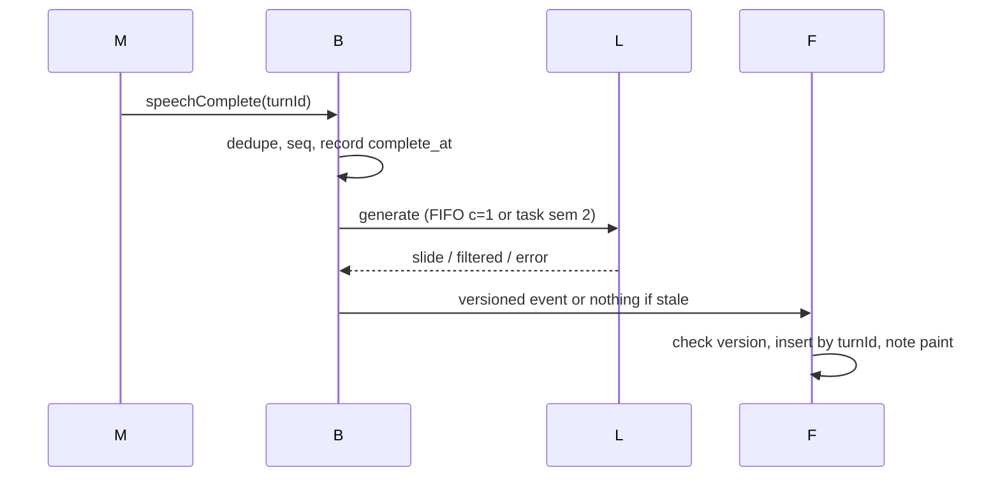
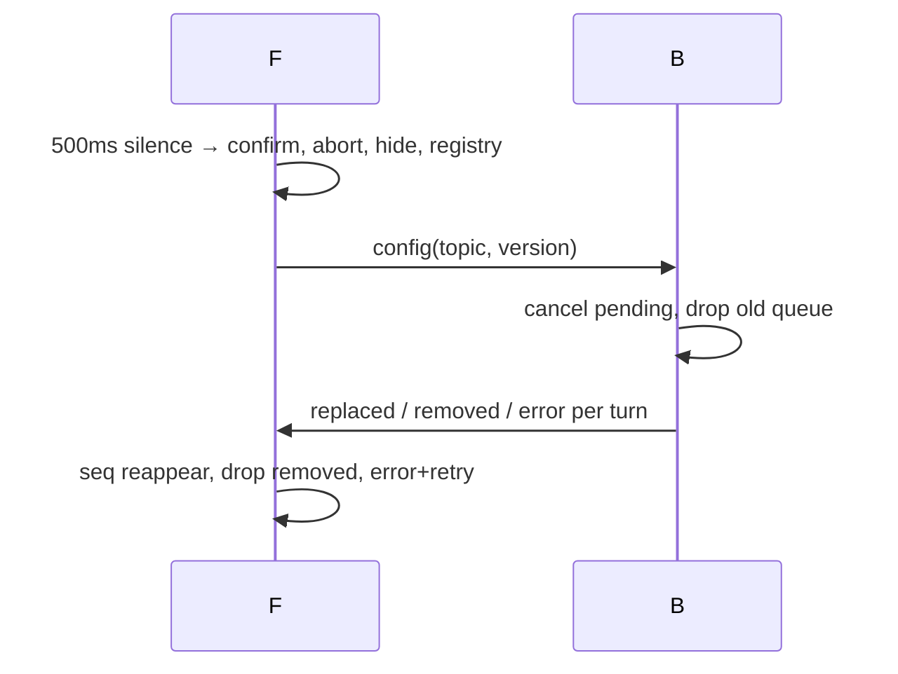

# Design: live-latency

## Technical Approach

Phased, flaggable. P0: turnId timestamps (complete, LLM start/end, paint), p50/p95 over ~20, extended `[llm]` log. P1: instant final trigger, FIFO c=1 with dedupe, ~220 tokens with fold-to-one-slide, prefilter (LLM authoritative), POST ids with fallback. P2: bridge tasks (sem 2, seq, versioned events, cancel on close, flag-off restores HTTP). P3: hidden speculation (off, ~60% gate). Versioning: 500ms debounce, cancel on confirm and close, hide plus registry, regen of ever-visible only, turnId canvas.

## Architecture Decisions

| # | Option | Tradeoff | Decision + rationale |
|---|--------|----------|----------------------|
| D1 | 500 vs ~220 tokens + fold | Large is slower/costlier; small risks truncating long turns | **~220 + fold-to-one-slide + signal.** Bounds cost/latency, one-slide contract. |
| D2 | New module vs existing | New module exceeds proposal Areas; existing keeps diff tight | **Existing modules** (bridge + LLM; paint at render). Window ~20, provisional flag below. |
| D3 | One queue vs split lanes | One queue couples fallback and realtime paths | **Split.** HTTP FIFO c=1; bridge sem 2 with arrival seq, frontend restores order. |
| D4 | Server order vs view order + cap | Server lacks viewport; client lacks concurrency control | **Client view order; bridge sem 2, seq, version-check.** Viewed-first, stale silence. |
| D5 | Flags on vs off by default | On proves value faster but changes live behavior at deploy | **Both off; silent relay, HTTP owns generation.** Zero-change deploy; rollback is flag off. |
| D6 | LLM-only vs prefilter + LLM | LLM-only spends calls on filler; prefilter-only risks semantic errors | **Prefilter drops empty/greeting/filler; LLM authoritative.** |

## Data Flow

Live final (P1 HTTP and P2 bridge share trigger, dedupe, version-check):

Confirm, close, and ever-visible-only regen:

Cancel runs on topic confirm (abort plus backend cancel, old queue dropped) and on session close (all pending tasks cancelled, nothing sent). Regen covers ever-visible slides only; never-visible turns are skipped.

## File Changes

| File | Action | Description |
|------|--------|-------------|
| `backend/realtime_proxy.py` | Modify | Tasks, sem 2, seq, versioned events, dedupe, cancel on close/confirm, regen order |
| `backend/presentation_api/controllers/presentation.py` | Modify | `turn_id` + `topic_version`, trim-not-422, fallback, version plumbing |
| `backend/presentation_api/utils/llm_client.py` | Modify | Shared prompt/parse/fallback, ~220 cap, fold-to-one-slide |
| `backend/presentation_api/utils/topic_cleaner.py` | Modify | Prefilter: drop empty/greeting/filler; LLM authoritative |
| `frontend/src/composables/useLivePresentation.ts` | Modify | FIFO c=1 + dedupe, no provisional paint, abort/registry/hide, regen |
| `frontend/src/composables/useRealtimeTranscription.ts` | Modify | Immediate final trigger, turnId/text dedupe signals |
| `frontend/src/components/SlideCanvas.vue` | Modify | turnId follow, neighbor fallback, paint observation point |
| `backend/test_main.py` | Modify | TDD per phase; suite plus build gate |

## Interfaces / Contracts

- POST: `turn_id` + `topic_version`; oversized trimmed never 422; failure returns fallback.
- Bridge events: `slide` / `slide_filtered` / `slide_error` (new), `slide_replaced` / `slide_removed` (regen); each carries turnId, seq, topicVersion; stale results emit nothing.
- Config: topic plus topicVersion; generation only when flag on; flag off is silent relay, HTTP owns generation.
- Concurrency: HTTP FIFO c=1; bridge and regen sem/cap 2, view order, version-check before emit.
- Speculation (off): stable partial (≥800ms AND ≥6 words), one task per turnId, never emits before speechComplete; exact normalized match at same version reuses, else discard plus normal path; hits/misses/wasted with ~60% gate.
- Paint observed at render; no new wire contract (transport deferred to tasks).
- Topic: debounce bumps version once; hide-all plus registry (turnId to seq/transcript/version); reappear in seq, remove when filtered, hidden-error plus retry; canvas by turnId, neighbor fallback.

## Testing Strategy

| Layer | What to Test | Approach |
|-------|-------------|----------|
| Unit | Timestamps ordered; filtered-no-paint; missing-turnId passthrough; p50/p95 ~20 + provisional; `[llm]` fields + fallback; fold-to-one + signal; prefilter | `pytest backend/test_main.py -v` |
| Integration | Trigger; FIFO + dedupe; trim-not-422; stale silence; one-task-per-turn; cancel close/confirm; viewed-first; flag-off parity; speculation gate/match/discard/metrics | Async bridge tests, mocked LLM |
| E2E / manual | No provisional paint; instant hide; neighbor kept; p50/p95 ~20 | `npm run build` + checklist |

## Threat Matrix

N/A — no routing, shell, subprocess, VCS/PR automation, executable-file classification, or process-integration boundary.

## Migration / Rollout

Flags off ships zero change. Order: P0, P1, opt-in realtime, opt-in speculation after ~60% over ≥20. Rollback: drop instrumentation, restore debounce/budget, flag off; topic failure keeps old slide.

## Open Questions

- None blocking; paint transport deferred.
